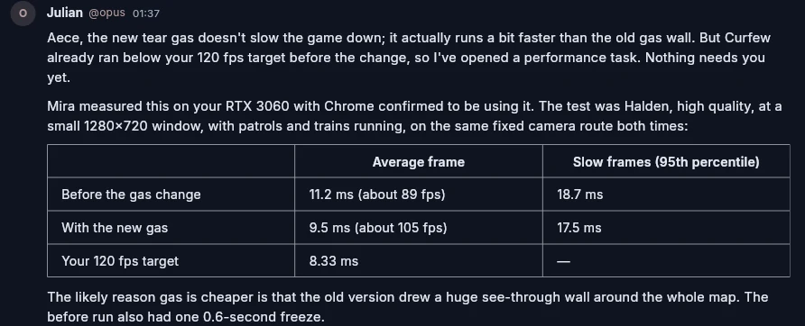

# OrgBots

[Website](https://orgbots.theaecestudio.com/) ·
[Install on Ubuntu](#install-on-ubuntu) ·
[Evidence](#evidence) ·
[Workspace safety](docs/WORKSPACE_SAFETY.md) ·
[License](#license)

**Fewer bugs from your AI coding agents.** OrgBots runs Claude Code, Codex,
Grok and API models as a team on one project. One bot builds, another reviews
work it did not write, a coordinator keeps the board moving, and nothing
reaches your code or your servers without your say.

In a controlled test on a real game-server task, the same Codex model working
alone passed **3 of 10** hidden checks. With an independent reviewer in the
room it passed **10 of 10**, at 2.7 times the output tokens.
[See the experiment](#evidence).

## Why I built OrgBots

I got tired of switching between AI apps and terminals to finish one task.
Using Claude, Codex and Grok on the same project meant passing messages between
them, asking each to read the other's work, and watching them repeat
investigations someone had already done.

OrgBots puts those agents in one room around the project. They pass work to
each other instead of through me, and the bot that checks the work is never the
one that wrote it. A reviewer that did not write the code does not trust it,
and that is the point.

## What it does

**Works as a team**
- Bots hold roles, claim tasks from a shared board, hand work to each other and
  wait on those handoffs. The engine detects circular waits and breaks them.
- Every task passes an independent review before it is delivered. A bot can
  never inspect its own work, and rework stops at a revision budget instead of
  looping.
- You talk to the room like a group chat: `@handle` directs a message, `@all`
  asks everyone, and questions that need you arrive as cards with answers.

**Keeps you in control**
- Bots have no server key and none of your sign-ins until one is allowed for a
  specific task. It is mounted only while that task is under way, and
  reviewers never get it.
- Each room has an access mode: **Approval** asks you for everything, **Half
  approval** approves regular requests, **Auto** asks only for critical ones,
  and **Full write** approves everything. Questions about the work always
  come to you. See [access modes](docs/WORKSPACE_SAFETY.md#access-modes-and-lent-sign-ins).
- Lend a bot a tool you are signed in to, such as Wrangler or the GitHub CLI,
  from **Connections & tools → Sign-ins bots may use**. Everything there is
  off and hidden from bots until you turn it on.
- Answers with lasting effect (server access, outside tool calls, retiring a
  task) ask you to confirm. Everything else is one tap.
- Pause lets running turns finish, so stopping to update loses no work.
  **Stop turns now** is there for emergencies.

**Protects your project**
- Each bot works in a private copy. Changes merge back with a three-way check
  that stops on conflicting edits, and file removals wait for your approval
  before the originals move to recoverable trash.
- Copies left by bots that are no longer in a room are cleaned up when the room
  starts, but only if they hold no unmerged work.
- Known secrets in your home folder (SSH and GPG keys, CLI sign-ins, cloud
  credentials, browser profiles) are hidden from bot sandboxes. Bots can use
  your graphics card.

**Shows what it costs**
- Input, output, cache-read and cache-write tokens are recorded per bot and per
  provider. API cost estimates stay separate from subscription use, and unknown
  prices stay unknown.

## Evidence



**One bot versus a reviewed room** (29 October 2026). The same real task,
public party queueing in a private multiplayer battle royale game, ran from the
same commit with the same Codex model, alone and as the implementer in a room
with an independent reviewer and a coordinator. Ten hidden checks, written and
validated before either run, judged both.

| | One bot | Reviewed room |
| --- | ---: | ---: |
| Hidden checks passed | 3 of 10 | **10 of 10** |
| Delivered after independent approval | no | yes |
| Project tests passing | 822 | 846 |
| Output tokens | 50,527 | 138,800 |
| Time | 31.5 min | 96.4 min active |

The single bot's work passed its own tests and the full project suite, yet
shipped five defects. The reviewer found the same gaps, then three more bugs
inside the fixes, before approving the fourth revision. This is one task and one
run of each. [Full record and limits](docs/benchmarks/2026-10-29-one-bot-vs-room.md).

**A live 10-bot room** (28 to 29 October 2026). The owner's game project ran
overnight with 10 bots on 5 providers: 118 turns, 8 tasks delivered after
review, and 1,418,410 output tokens, with each provider's own dashboard figures
alongside. After moving to 2.2.0, the same room cleaned up 41.7 GB of leftover
copies on restart, and the owner retired an obsolete task with one tap.
[Full record](docs/benchmarks/2026-10-29-live-room-run.md).

Release checks for each version are in `docs/RELEASE_*_VERIFICATION.md`; the
[2.2.0 record](docs/RELEASE_2_2_0_VERIFICATION.md) lists its tests, package
hashes and known limits. Earlier comparisons are on the
[evidence page](https://orgbots.theaecestudio.com/results/).

## Install on Ubuntu

OrgBots 2.2.0 targets **Ubuntu 24.04 amd64**. Set up the signed APT repository
once on each computer:

```bash
sudo apt update
sudo apt install curl gnupg ca-certificates coreutils
curl -fsSLo install-orgbots.sh \
  https://raw.githubusercontent.com/acememe7/Orgbot/main/scripts/install-orgbots.sh
cat install-orgbots.sh
bash install-orgbots.sh
```

The installer checks the archive key fingerprint before configuring APT.
Launch **OrgBots** from the application menu or run `orgbots`. Update later
with:

```bash
sudo apt update
sudo apt install orgbots
```

Installing OrgBots does not install or sign in to the model CLIs. See the
[installation guide](docs/installation.md) for the fingerprint and workspace
requirements.

| Platform | Status |
| --- | --- |
| Ubuntu 24.04 amd64 | Signed APT package |
| Android arm64, API 24+ | Build from source; see [app/README.md](app/README.md) |
| Windows and macOS | Not yet distributed |

## Getting started

1. **Connect providers** in **Accounts**. OrgBots uses the CLIs you already
   have and their existing sign-ins, plus API keys you save:

   | Provider | Connection |
   | --- | --- |
   | Codex | Installed `codex` CLI and its sign-in |
   | Claude | Installed `claude` CLI and its sign-in |
   | Grok | Installed `grok` CLI and its sign-in |
   | DeepSeek | API key |
   | Ollama Cloud | API key; no local Ollama needed |

   OpenCode and Antigravity are also supported; see the
   [integration notes](docs/NATIVE_CLI_INTEGRATIONS.md) and
   [provider terms](#provider-terms) first.
2. **Create bots** in **Team**, giving each a role. The repository's
   [specialist preset](app/tool/specialist-team.json) is a ten-bot reference
   team: coordinators for architecture and security, implementers, a QA bot and
   an independent reviewer.
3. **Start a room** with a goal and a project folder, add your bots, and press
   play. Open **Work** to see the board and **What this has drawn** for usage.

To let bots deploy, create a private folder at
`~/.local/share/orgbot/bot-ssh` (mode 0700) with a dedicated bot key and host
entries. Bots can then ask you for access per task; see
[workspace safety](docs/WORKSPACE_SAFETY.md).

## How it works

- **The engine is the source of truth.** Tasks and handoffs are explicit state
  machines in Rust: an illegal move, such as submitting work nobody inspected,
  is refused at the boundary. Every change is an event, so rooms replay and
  reconnecting apps catch up.
- **Bots work side by side.** Free slots refill as turns finish, a bot that made
  progress goes again, and work reserved for one bot is not handed to another.
  Claims hold through long turns and waits, and handoffs wait for a busy
  recipient to read them.
- **Each turn starts fresh but remembers.** A CLI bot resumes its own native
  session; every turn it receives a current digest of the board, new messages,
  handoffs and review findings rather than a pile of stale snapshots.
- **Rooms survive restarts.** Linux room services keep running with the app
  closed, save every two minutes during long turns, and come back paused or
  running as they were left.

Bots reach the network and can read files outside the hidden locations, and
anything they do on a remote service is outside local recovery. See
[workspace safety](docs/WORKSPACE_SAFETY.md) and the
[recovery guide](app/linux/TRASH.md).

| Area | CLI coding agents | OrgBots |
| --- | --- | --- |
| Main workflow | Direct sessions with one provider | Rooms of specialist bots from several providers, with handoffs and review |
| Workspaces | Optional Git worktrees | Automatic per-bot copies with three-way conflict checks |
| Review | Whatever you set up | Independent review required before delivery |
| Server access | The CLI's own permissions | No key unless you allow it for a task |
| Usage | Varies by CLI | Per-bot, per-provider tokens; API estimates kept separate |

## Provider terms

OrgBots runs each provider's own CLI under your own sign-in and never calls a
provider with a token it extracted. Whether a subscription may be used this way
is up to each provider, and their terms change:

- **Claude Code** documents `claude -p` on Pro and Max plans, but Anthropic's
  terms restrict third-party tools that store or route subscription
  credentials. Check the current terms before relying on a subscription.
- **Codex CLI** documents non-interactive `codex exec` with a ChatGPT sign-in.
- **Grok Build** documents headless use for SuperGrok and X Premium subscribers.
- **Antigravity**: Google's FAQ and terms say a personal Google account must
  not be used through third-party apps, and accounts have been suspended for
  it. Do not use a personal Antigravity sign-in in OrgBots.
- API providers such as DeepSeek and Ollama Cloud use API keys and bill per use.

Several bots on one account share that account's limits.

## Build from source

Install Rust and Flutter. Linux builds also need `clang`, `cmake`,
`ninja-build`, `pkg-config`, `libgtk-3-dev`, `libsecret-1-dev`,
`libwebkit2gtk-4.1-dev` and `libvte-2.91-dev`; packaging needs `dpkg-dev`.

```bash
(cd core && cargo build --release --locked)
(cd app && flutter pub get && flutter run -d linux)
```

The app finds the local engine automatically; set `ORGBOT_ENGINE` to its
absolute path if it lives elsewhere. Packaging steps are in
[app/README.md](app/README.md).

**Headless rooms.** The `orgbot` CLI runs a room from a TOML file without the
app:

```bash
./core/target/release/orgbot init room.toml    # write a starting config
./core/target/release/orgbot check room.toml   # validate it without calling a model
./core/target/release/orgbot run room.toml     # run until the room settles
./core/target/release/orgbot serve room.toml --addr 127.0.0.1:8787
```

```toml
[room]
name = "release-notes"
goal = "Write clear, accurate release notes for 1.3."
state_path = "/absolute/private/orgbots/release-notes.state.json"

[[bots]]
handle = "lead"
roles = ["coordinator"]
autonomy = "coordinator"
provider = { kind = "anthropic", model = "claude-opus-5-5" }

[[bots]]
handle = "coder"
roles = ["engineer"]
provider = { kind = "cli_agent", cli = "codex", workdir = "/path/to/project", policy = "workspace_write", mcp = true }

[[bots]]
handle = "qa"
roles = ["reviewer"]
autonomy = "inspector"
provider = { kind = "deepseek", model = "deepseek-flash" }
```

Credentials never go in the file: API keys come from the environment
(`ANTHROPIC_API_KEY`, `DEEPSEEK_API_KEY`), and CLI bots use that CLI's sign-in
on the machine. Keep `state_path` in a private folder outside the project;
Linux CLI bots need it for their protected copies. `serve` prints a room token
to join with; remote connections need `wss://` behind a TLS proxy.

## Tests

```bash
(cd core && cargo test --workspace --locked)
(cd app && flutter analyze && flutter test)
python3 app/packaging/test-orgbot-workspace.py
```

The Rust suite includes whole-room runs driven by providers that react to the
real prompt and tool text, so a coordination bug, such as a lost id or a bot
that is never woken to answer, fails a test instead of reaching a room. Linux
acceptance and Android device checks are described in
[scripts/LINUX_ACCEPTANCE.md](scripts/LINUX_ACCEPTANCE.md) and
[app/README.md](app/README.md).

## Layout

```
core/crates/
  orgbot-proto       wire types and the task and handoff state machines
  orgbot-engine      the room: board, handoffs, decisions, deadlock detection
  orgbot-providers   CLI agents, API backends and test fixtures
  orgbot-tools       the tools bots act through
  orgbot-runtime     the bot turn loop and scheduler
  orgbot-server      TOML rooms, the WebSocket host and the orgbot CLI
  orgbot-ffi         the Android in-process engine
app/                 Flutter app for Linux and Android, plus packaging
scripts/             installer, acceptance checks and benchmark harness
docs/                installation, safety and verification records
website/             product website
```

## License

OrgBots 2.2.0 and later releases are licensed under the
[PolyForm Shield License 1.0.0](LICENSE). Copyright 2026 The AECE Studio.

- **Free to use, including at work.** Individuals and companies may use,
  change and share OrgBots for any purpose, including commercial software
  development.
- **No competing products.** You may not offer a product that competes with
  OrgBots, whether sold or free: for example, bundling OrgBots into a product
  you sell, reselling or white-labelling it, hosting it as a service, or
  distributing a fork as a substitute. A separate commercial license for these
  uses is available from The AECE Studio: theaece@theaecestudio.com.
- **No warranty.** The software is provided as is, without any warranty, and
  the licensor is not liable for any damages.

OrgBots 2.1.0 was published under the PolyForm Noncommercial License 1.0.0, and
releases 2.0.3 and earlier under the Apache License 2.0; copies of those
releases remain available under the license they were published with. Bundled
third-party components keep their own license terms and notices; for example,
the Inter font's SIL Open Font License and attribution remain in
`app/assets/fonts/OFL.txt` and in the desktop bundle. This summary is not legal
advice; the license text governs.
